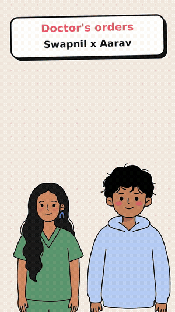

<p align="center"></p>

<h1 align="center">Rigpop for Agents</h1>

<p align="center">
<b>Scripts in, talking doodle videos out.</b><br>
A CLI, MCP server and agent skill that turn a few lines of dialogue into a voiced, lip-synced,<br>
gesturing, captioned 9:16 MP4. Free voices, bundled ffmpeg, no API keys, no browser.
</p>

<p align="center">
<a href="examples/doctors-orders.mp4"><b>▶ Watch the demo with sound</b></a> ·
<a href="examples/doctors-orders.md">See the script that made it</a> ·
<a href="https://rigpop-talk.vercel.app/">Rigpop Talk (the browser app)</a>
</p>

---

Most agents can only hand you text or code. Give one this tool and it hands you a **finished video**: characters that talk in real voices, move their mouths to the audio, blink, wave and point on cue, with word-by-word captions ready for Reels, Shorts and LinkedIn.

```bash
npx github:swapagrawal14/rigpop-agents init reel.md      # starter script
npx github:swapagrawal14/rigpop-agents render reel.md     # -> reel.mp4
```

## ✍️ The script

```markdown
---
title: Doctor's orders
subtitle: Swapnil x Aarav
cast:
  S: { character: doodle-swapnil, name: Swapnil, voice: en-IN-NeerjaExpressiveNeural }
  A: { character: aarav, name: Aarav, voice: en-IN-PrabhatNeural, pitch: +18Hz }
---

S (happy): [wave] Hello Aarav! Did you brush your teeth today?
A: Umm... does chewing gum count? [pause 0.3]
S (excited): No! [point] Listen, here's a tip. Brush twice a day, for two whole minutes.
A (sad): Two minutes? That's so long!
```

| Piece | What it does |
|---|---|
| `KEY: text` | One spoken line. `KEY` comes from `cast` |
| `(mood)` | `happy` `excited` `calm` `sad` `angry` `whisper`: shifts voice pitch and speed, and how bouncy the doodle is |
| `[wave]` `[point]` `[open]` `[thumbs]` | Gesture fires on the word it sits before. Words like *hello*, *tip*, *great*, *why* trigger gestures on their own too |
| `[pause 0.5]` | Extra silence after the line |
| `background` | `dots`, `grid`, `plain`, a `#hex` colour, or an image |
| `size` | `720x1280` (default), `1280x720`, `1080x1080`… |
| `music` | Any audio file, looped quietly under the voices |

Full reference: [`skills/rigpop/SKILL.md`](skills/rigpop/SKILL.md).

## 🧰 Commands

| Command | |
|---|---|
| `rigpop render script.md -o reel.mp4` | Render the video. Add `--json` for a machine-readable result |
| `rigpop still script.md --at 3` | One PNG frame, to check the look in a second |
| `rigpop check script.md` | Validate without rendering |
| `rigpop characters` / `rigpop voices` | What's available |
| `rigpop init` | Write a starter script |
| `rigpop render … --silent` | No TTS (offline/CI): mouths move to a synthetic hum |
| `rigpop mcp` | Start the MCP server |

## 🤖 Use it from your agent

**Claude Code / Codex / Gemini CLI (skill).** Copy the skill into your project and the agent learns the format and the workflow:

```bash
mkdir -p .claude/skills && cp -r node_modules/rigpop-agents/skills/rigpop .claude/skills/
# or just point your agent at skills/rigpop/SKILL.md in this repo
```

**Any MCP client (Claude Desktop, Cursor, Claude Code…).**

```json
{
  "mcpServers": {
    "rigpop": { "command": "npx", "args": ["-y", "github:swapagrawal14/rigpop-agents", "mcp"] }
  }
}
```

Tools: `rigpop_guide`, `rigpop_characters`, `rigpop_voices`, `rigpop_check`, `rigpop_still` (returns the image so the agent can look), `rigpop_render`.

Then just ask: *"Make a 30-second reel where Biscuit explains why cats knock things off tables."*

**From code.**

```js
import { parseScript, render } from 'rigpop-agents';
await render(parseScript(scriptText), 'out.mp4');
```

## 🌷 Cast

| id | | gestures |
|---|---|---|
| `doodle-swapnil` | Soft doodle girl in scrubs | 👋 ☝️ 🤲 👍 |
| `aarav` | Soft doodle boy in a hoodie | 👋 ☝️ 🤲 👍 |
| `biscuit` | Doodle tabby cat | 👋 ☝️ 🤲 👍 |
| `dr-swapnil` | Blue-ink comic dentist in scrubs | 👋 ☝️ 🤲 👍 |
| `swapnil-classic`, `mochi`, `froggo` | The original talking heads | talk + blink |

**Your own doodle:** `character: ./my-drawing.png` and it squashes and bounces as it talks. For real mouth shapes, add a folder with `character.json` plus `_base`, `_A`, `_O`, `_E`, `_blink` (and optional `_pose_wave` etc.) PNGs. [Rigpop Talk](https://rigpop-talk.vercel.app/) sets these up from any drawing.

## 🗣️ Voices

Free Microsoft Edge neural voices, 400+ across languages. Some picks: `en-IN-NeerjaExpressiveNeural`, `en-IN-PrabhatNeural`, `hi-IN-SwaraNeural`, `hi-IN-MadhurNeural`, `en-US-AriaNeural`, `en-GB-RyanNeural`, `ja-JP-NanamiNeural`. Clips are cached, and long TTS pauses are trimmed so dialogue stays snappy.

## ⚙️ How it works

1. Each line goes to Edge TTS (with pitch and rate from the cast and mood) and is decoded with a bundled ffmpeg.
2. Silences are tightened, lines are laid on a timeline, music is mixed underneath.
3. Every frame, loudness and zero-crossing rate pick a mouth shape (A, O, E, rest); blinks, bobbing, and gestures run on a seeded clock, so the same script renders the same video.
4. Frames are drawn with `@napi-rs/canvas` and streamed straight into x264. A 40-second reel renders in under a minute on a laptop.

## 🧭 Roadmap

- Word-level timing from TTS for even tighter captions
- Hindi/Hinglish auto-gesture words in scripts
- Camera moves (zoom on the speaker, cuts)
- Scene changes and props mid-script
- `npm` release (`npx rigpop-agents`)

Made by [Swapnil Agrawal](https://github.com/swapagrawal14). Characters and engine from [Rigpop Talk](https://github.com/swapagrawal14/rigpop-talk). MIT licensed.
